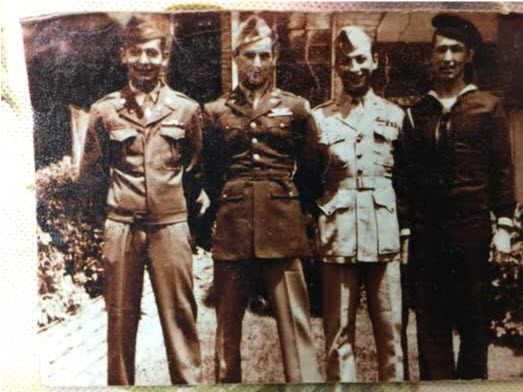

  
# The Schneider Prize for Technology Innovation

### Presented by MRG Laboratories

(L–R) Frank Schneider, US Army; Dr. Tony Schneider, US Army Air Corps; Dr. Henry Schneider, US Marines; Edward A. Schneider, Jr., US Navy

The Schneider Prize for Technology Innovation was founded in 2017 to honor the accomplishments of the Schneider family of York County, PA. Four brothers from York enlisted in the four branches of the military during World War II, while their sisters and parents served at home. The brothers returned to become scientists, engineers and civil servants, making their mark on our community. This prize honors their family's achievements in our community and will be awarded to a Hack that results in ideas and innovations for communicating and educating about specific technology.

<strong>2018</strong> – The prize was offered to the developer or team of developers that could improve upon the use of our current Grease Thief® technology. The winning team shared the $1,000 prize for their coding design and solution for creation of a criteria data set that generated actions based on lubricant color changes. This led to our current patented Grease Thief Colorimeter that customers can use on-site to analyze and quantify color changes in grease.

<strong>2021</strong> – The prize addressed using a Raspberry Pi to develop a program to connect and collect data from multiple devices (such as sensors, scales, barcode scanners, any student-designed device, etc.) to be uploaded to a website via an HTTP request. The winning entry was able to demonstrate a design linked to their previous work as an intern in the York College Manufacturing Fellowship grant project.

## The 2026 Challenge

<blockquote>
  <strong>Create an efficient way for the laboratory to take information from hand-written or typed-and-printed sample labels and convert that to a digital format which can be uploaded to our database.</strong>
</blockquote>

### Prizes

Prizes are split amongst all members of the group.

<table>
  <tr><th>Place</th><th>Prize</th></tr>
  <tr><td>1st</td><td>$1,000</td></tr>
  <tr><td>2nd (if applicable)</td><td>$500</td></tr>
</table>

## Write-up

MRG Labs designs instrument solutions for deployment in analytical laboratories and for end-users as mini-lab solutions, allowing the evaluation of greases sampled from machinery to determine grease condition, contamination levels, and equipment health. As a part of this process, MRG Labs receives hundreds of oil and grease samples a week, and each sample will have its label's information read and logged by hand. The goal of this project is to quicken and automate the lab's cataloguing process and achieve a two-fold effect of freeing up time for our technicians and shortening the turn-around time for our customers.

## Requirements

A successful project should achieve three main goals:

<ol>
  <li>A way to scan the labels on the samples.</li>
  <li>Software that reads the contents of the labels.</li>
  <li>A holistic program that includes creating and populating a <code>.csv</code> file.</li>
</ol>

## Input

There are two main sample types, referred to for simplicity as **"Large"** and **"Small"**. The labels may be in varying conditions.

<table>
  <tr>
    <td align="center"> <b>Figure 1:</b> Large Sample Tube</td>
    <td align="center"> <b>Figure 2:</b> Small Sample Tube</td>
  </tr>
</table>

Every group will have access to official samples of varying conditions and sizes.

*See the [Resources](#resources) section for more info and examples.*

## Output

A `.csv` file named via user input. The file should contain **only 7 columns**; the table below is a guide for where the information for each column is found on both labels. Any field left empty on the label should be empty in the `.csv`.

<table>
  <tr>
    <th></th>
    <th>Sample ID</th>
    <th>Date Sampled</th>
    <th>Date Received</th>
    <th>Machine</th>
    <th>Component</th>
    <th>Serial Number</th>
    <th>Reference Lube</th>
  </tr>
  <tr>
    <td><b>Large</b></td>
    <td>Barcode or Num</td>
    <td>"Date"</td>
    <td>Today's Date</td>
    <td>Equip ID</td>
    <td>Sample Point</td>
    <td>Leave Blank</td>
    <td>Ref Lube</td>
  </tr>
  <tr>
    <td><b>Small</b></td>
    <td colspan="3" align="center">(see Large)</td>
    <td>RN</td>
    <td>Circled Num + Circled GS/NGS</td>
    <td>SN</td>
    <td>Leave Blank</td>
  </tr>
</table>

*See the [Resources](#resources) section for more info.*

## Judging Criteria

Each team's solution will be judged on **design**, **execution**, and **creativity**. The team that makes the best solution will receive a **$1,000 Grand Prize**. If a second worthy submittal is received, a **Reserve Prize of $500** will also be awarded.

## More Information

Questions can be answered in a brainstorming session given by JD Brown Center for Entrepreneurship Center member MRG Labs during the Hackathon. Insight will be provided by Rich Wurzbach (President) and Dylan Kletzing (Lab Manager). You can also join our discord channel 

**Good luck to all the Hackathon participants!**

---

## Resources

<table>
  <tr>
    <td valign="top">
      <h3>Resources Folder</h3>
      <a href="https://mrgcorp-my.sharepoint.com/:f:/p/sneuman/IgBpZfL1WdvCS5OMTPnawyszAcVfJRdfriwOPIC2CENa68g?e=PtLyiv">Hackathon 2026</a>
      <ul>
        <li><a href="https://mrgcorp-my.sharepoint.com/:f:/p/sneuman/IgB0_oZG3NG8TaV9kUvmt1w3AV1W7oN6G73ZB7D_UYh077Q?e=mAJJ8d">Example_Photos</a></li>
        <li><a href="https://mrgcorp-my.sharepoint.com/:x:/p/sneuman/IQDjKc6abAROTL5bu2s72EC2ARWUh2oHo7GCYOhJb6K-wG0?e=iEmfEf">output_empty.csv</a></li>
        <li><a href="https://mrgcorp-my.sharepoint.com/:x:/p/sneuman/IQD9gHil2hzlTIXcZoxYWV15AcykqwmlWd7Wq2dcvRGiEjM?e=VgLyNv">output_example.csv</a> (based on the example photos)</li>
        <li>Schneider Prize Write Up</li>
      </ul>
    </td>
    <td align="center">
       
      Scan for the Resources Folder
    </td>
  </tr>
</table>

### Large Sample

<table>
  <tr>
    <td align="center"> <b>Figure 1:</b> Large Sample Tube</td>
    <td align="center"> <b>Figure 3:</b> Large Sample Label</td>
  </tr>
</table>

### Small Sample

<table>
  <tr>
    <td align="center"> <b>Figure 2:</b> Small Sample Tube</td>
    <td align="center"> <b>Figure 4:</b> Small Sample Label</td>
  </tr>
</table>

### Label to Spreadsheet Guide

  

### Program Flow Chart

Provided is a rough example of what the project may entail. This is not a required list of steps and there is no competitive advantage to following it.

  

